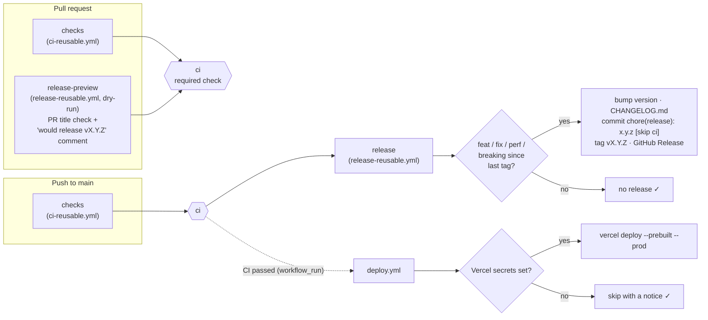

# ci-cd-template

[](https://github.com/luxmoncoeur/ci-cd-template/actions/workflows/ci.yml)
[](https://github.com/luxmoncoeur/ci-cd-template/actions/workflows/deploy.yml)
[](https://github.com/luxmoncoeur/ci-cd-template/releases)
[](https://github.com/semantic-release/semantic-release)


Reusable GitHub Actions workflows for Node projects:

- **CI:** lint, typecheck, test with a coverage summary, and build, in parallel behind one required check.
- **Releases:** fully automated with [semantic-release](https://github.com/semantic-release/semantic-release).
  The commit messages decide the version. Each release updates `CHANGELOG.md`, tags the commit and creates
  a GitHub Release. Pull requests get a "this PR would release vX.Y.Z" preview.
- **Deploy:** optional Vercel deploy, skipped cleanly when not configured.

It all runs on GitHub Actions with nothing but `GITHUB_TOKEN`, which is free on public repos. There are
no paid services and no API keys. Nothing is published to npm.

The repo contains a small TypeScript sample app ([src/bump.ts](src/bump.ts)), so the pipeline always
runs against real code. The sample is a tiny model of the same versioning rules.

## Pipeline



Inside `checks`, an `install` job warms the dependency cache. Then lint, typecheck, test and build
run in parallel.

| Workflow | Trigger | What it does |
| --- | --- | --- |
| [`ci-reusable.yml`](.github/workflows/ci-reusable.yml) | `workflow_call` | Install (cached), then lint, typecheck, test (with coverage summary) and build in parallel. Each step can be turned off with an input. |
| [`release-reusable.yml`](.github/workflows/release-reusable.yml) | `workflow_call` | **Release mode:** semantic-release bumps the version, writes the changelog, commits it back, tags the commit and creates the GitHub Release. **Dry-run mode (PRs):** checks the PR title and predicts the release. |
| [`ci.yml`](.github/workflows/ci.yml) | push to `main`, PRs | This repo's pipeline. It calls both reusable workflows. The aggregate `ci` job is the only check branch protection needs, and `release` runs after it on `main`. |
| [`deploy.yml`](.github/workflows/deploy.yml) | CI passed on `main` | Optional Vercel production deploy. Skips with a notice when the secrets are missing and never fails because of them. |

## Use it in your repo in 5 lines

```yaml
# .github/workflows/ci.yml
on: [push, pull_request]
permissions: { contents: read }
jobs:
  checks:
    uses: luxmoncoeur/ci-cd-template/.github/workflows/ci-reusable.yml@main # pin to a tag or SHA in real use
```

Your repo needs a lockfile and `package.json` scripts named `lint`, `typecheck`, `test` and `build`.
With pnpm it also needs a `"packageManager": "pnpm@x.y.z"` field. Inputs, all optional:

```yaml
    with:
      node-version: "24"        # default "22"
      package-manager: npm      # pnpm (default) | npm | yarn (Berry, via corepack)
      run-lint: true            # default true
      run-typecheck: true       # default true
      run-test: true            # default true
      run-build: false          # default true
```

For a coverage table in the test job's summary, have your test runner write
`coverage/coverage-summary.json` (the istanbul `json-summary` reporter, which Vitest, Jest and c8 all
support).

### Add automated releases

Add these two jobs next to `checks`. Your repo doesn't need semantic-release in its `package.json`: the
workflow installs pinned versions itself.

```yaml
  release-preview:
    if: github.event_name == 'pull_request'
    permissions: { contents: read, pull-requests: write }
    uses: luxmoncoeur/ci-cd-template/.github/workflows/release-reusable.yml@main
    with: { dry-run: true }

  release:
    needs: checks
    if: github.event_name == 'push' && github.ref == 'refs/heads/main'
    permissions: { contents: write }
    concurrency: { group: release, cancel-in-progress: false }
    uses: luxmoncoeur/ci-cd-template/.github/workflows/release-reusable.yml@main
```

Add `types: [opened, synchronize, reopened, edited]` under `pull_request`, so that renaming a PR
re-runs the title check. Release inputs, all optional:

| Input | Default | Meaning |
| --- | --- | --- |
| `dry-run` | `false` | Predict instead of release, and check the PR title. |
| `node-version` | `"22"` | Node for semantic-release (needs 22.22.2+ or 24.15+). |
| `changelog-file` | `CHANGELOG.md` | Changelog to write. |
| `bump-package-json` | `true` | Write the version into `package.json` (turn off if there isn't one). |
| `squash-merge` | `true` | Dry-run: predict from the PR title (squash merge). With `false`, the PR's own commits are used and the title isn't checked. |
| `comment` | `true` | Dry-run: post or update one preview comment on the PR. |

The secret `deploy-key` is optional; see [Protecting `main`](#protecting-main). The workflow's outputs
are `released`, `version`, `tag` and `type`.

To customize releases (other branches, extra plugins, release rules), add your own
[semantic-release config](https://semantic-release.gitbook.io/semantic-release/usage/configuration) to the
repo. It replaces the built-in defaults.

## How versions are decided

| Commit (or squash-merged PR title) | Release |
| --- | --- |
| `feat: …` | minor `1.4.2 → 1.5.0` |
| `fix: …` / `perf: …` | patch `1.4.2 → 1.4.3` |
| `feat!: …` or a `BREAKING CHANGE:` footer | major `1.4.2 → 2.0.0` |
| `docs`, `chore`, `ci`, `refactor`, `test`, … | no release |

The first release is `1.0.0`. The full cheat sheet is in
[docs/conventional-commits.md](docs/conventional-commits.md).

**Enforcement:**

- Locally, a husky `commit-msg` hook runs commitlint (installed by `pnpm install`).
- In CI, the PR title is checked, because squash merges use it as the commit message.

## Design choices

- **Every third-party action is pinned to a full commit SHA** with a `# vX.Y.Z` comment. A tag can be
  moved to point at different code; a commit SHA can't. semantic-release and its plugins are pinned to
  exact versions too.
- **Least-privilege tokens.** CI is `contents: read`, and the aggregate job gets nothing. Only `release`
  gets `contents: write`, and only `release-preview` gets `pull-requests: write`, for its comment. The
  reusable release workflow declares no permissions of its own. A called workflow that asks for more
  than its caller granted fails to start, so the calling job grants exactly what each mode needs.
- **Release comments and labels on released PRs are off**, so releasing needs only `contents: write`.
- **Release runs only after `ci` passes, inside the same workflow run.** No separate trigger to keep in
  sync, and the release job's concurrency group means one release at a time, never cancelled midway.
- **The release commit carries `[skip ci]`.** It only touches `CHANGELOG.md` and `package.json`, and
  the code in it was just tested, so it doesn't start CI (and with it deploy) again.
- **The PR preview is accurate for squash merges.** It analyses the commit `main` would actually get:
  the merged tree with the PR title as its message, on top of `main`. The PR's work-in-progress commits
  don't count. It runs with a read-only token, so it also works on PRs from forks (the comment is
  skipped there, and the job summary still shows the preview).
- **Concurrency.** A new push to a PR cancels that PR's outdated run. Runs on `main` are never
  cancelled, so every merge gets a complete result.
- **One required check.** The `ci` job runs with `if: always()` and fails if any upstream job failed
  or was cancelled. Without it, branch protection would treat a skipped check as passing, and you'd
  have to list every job as required.
- **No `paths-ignore`.** A required check whose workflow is skipped by a path filter stays "pending"
  forever and blocks the merge.
- **Deploy is a separate `workflow_run` workflow.** PR runs never see secrets. Deploy ships the exact
  commit CI tested (`head_sha`), and deploys queue instead of cancelling each other.
- **No cron.** GitHub turns off scheduled workflows after 60 days without repo activity. That rule
  doesn't apply here because nothing in this template runs on a schedule.

## Setting up the repo

**1. Merge settings** (Settings → General → Pull Requests):

- Tick **Allow squash merging**, and set **Default commit message** to **Pull request title**.
- Optionally, turn off merge commits and rebase merging so that every PR lands as one titled commit.

**2. Protecting `main`.** Create a ruleset (Settings → Rules → Rulesets → New branch ruleset) that
targets the default branch, with these rules:

- Require a pull request before merging.
- Require status checks to pass, with **`ci`** as the only required check.
- Block force pushes.

`GITHUB_TOKEN` can't bypass these rules, so the release job's push of its `chore(release)` commit
would be rejected. Let it through with a deploy key, which is free:

1. Generate a key pair locally:

   ```bash
   ssh-keygen -t ed25519 -N "" -C release-bot -f release-key
   ```

2. Settings → Deploy keys → **Add deploy key**. Paste `release-key.pub` and tick **Allow write
   access**.
3. Settings → Secrets and variables → Actions → New secret **`RELEASE_DEPLOY_KEY`**, with the contents
   of `release-key` (the private key). Then delete both files.
4. In the ruleset, under **Bypass list**, add **Deploy keys** (always allow).

Without the secret, releases push with `GITHUB_TOKEN`. That works as long as `main` isn't protected.

**3. Optional: Vercel deploys.** Add three repo secrets: `VERCEL_TOKEN`, `VERCEL_ORG_ID` and
`VERCEL_PROJECT_ID`. The two IDs are in `.vercel/project.json` after `vercel link`. Without them, the
deploy workflow skips with a notice and the run stays green.

## Local development

Requires Node 22+ ([.nvmrc](.nvmrc)) and pnpm via corepack.

```bash
pnpm install
pnpm lint
pnpm typecheck
pnpm test
pnpm build
```

| Script | Runs |
| --- | --- |
| `pnpm lint` | ESLint (flat config) |
| `pnpm typecheck` | `tsc --noEmit` |
| `pnpm test` | Vitest with v8 coverage (90% thresholds) |
| `pnpm build` | `tsc` to `dist/` |

`pnpm install` also installs the commit-msg hook. That only works inside a git repository, so run it
again after `git init` if you cloned without git history.

TypeScript is held at `~6.0.x` because `typescript-eslint` 8 supports `typescript <6.1`. Move to
TypeScript 7 once typescript-eslint supports it.
